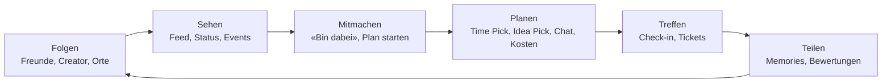

# 02 – Produktvision und Zielgruppen

> **Phase 1/2 – Produktanalyse und Produktstrategie** · Stand: 24.11.2026 · Status: Entwurf zur Freigabe

---

## 1. Produktvision

### Vision
**Pickeed ist das soziale Netzwerk für das echte Leben.**
Du siehst, was Freunde, Creator, Vereine und Orte in deiner Stadt machen – und mit einem Tipp wird
daraus ein gemeinsamer Plan, ein Treffen, eine Erinnerung.

### Mission
Wir verbinden Menschen, Creator und Unternehmen dort, wo es zählt: offline. Pickeed nimmt das
Hin und Her aus dem Organisieren, macht lokale Angebote sichtbar und gibt Creatorn und Businesses
ein Publikum, das wirklich kommt – ohne Werbetracking und mit Daten in der Schweiz.

### Positionierung (ein Satz)
Für Menschen zwischen 16 und 40, die mehr erleben wollen als scrollen, ist Pickeed die Social-App,
die aus «Wer kommt mit?» einen fixen Plan macht – anders als Instagram (Inhalte ohne Handlung),
WhatsApp (Chat-Chaos) oder Doodle (Planung ohne Gemeinschaft).

### Der Kernkreislauf (Core Loop)

Jede Funktion muss diesen Kreislauf stärken. Funktionen, die nur Verweildauer erhöhen
(endloser Video-Feed ohne Bezug zu Plänen), haben niedrige Priorität.

### Produktprinzipien

1. **Vom Sehen zum Hingehen.** Jeder Inhalt kann mit einem Tipp zu einem Plan werden.
2. **Privat zuerst.** Private Profile und Pläne sind Standard; öffentlich wird nur, was jemand bewusst veröffentlicht.
3. **Keine Werbung, kein Tracking, kein Datenverkauf.** Einnahmen kommen von Anbietern, Tickets und Profi-Funktionen – nicht von Aufmerksamkeit.
4. **Ehrliche Zahlen.** Statistiken basieren nur auf echten Daten; Rankings sind nicht käuflich, Gesponsertes ist gekennzeichnet.
5. **Ohne Hürde mitmachen.** Gäste machen per Link ohne Konto mit.
6. **Schweizer Qualität, international gedacht.** Mehrsprachig ab Tag 1, Datenhaltung in der Schweiz.
7. **Sicher für junge Menschen.** Mindestalter 16, Schutzmechanismen bis 18.

### Nordstern-Kennzahl

**Stattgefundene Pläne pro Woche** – Pläne mit mindestens zwei bestätigten Teilnehmenden,
deren Termin vorbei ist (optional bestätigt durch Check-in oder Memory).

Unterstützende Kennzahlen: wöchentlich aktive Personen (WAU), Anteil der Pläne mit festgelegtem
Termin, Gäste-zu-Konto-Konversion, Creator/Businesses mit mindestens einer Interaktion pro Woche,
Retention nach 4 Wochen.

---

## 2. Zielgruppen

### Übersicht

| Segment | Rolle im Netzwerk | Was sie wollen | Wie Pickeed verdient |
|---|---|---|---|
| **Privatpersonen** (16–40) | Nachfrage, Netzwerkeffekt | Freunde treffen, ohne Chat-Chaos; sehen, was läuft | gar nicht (bewusst kostenlos) |
| **Creator** | Inhalte, Reichweite, Events | Gefunden werden, Buchungen, Community, Kooperationen | Profi-Funktionen, Ticketgebühr, ggf. Buchungsgebühr |
| **Anbieter** (Restaurants, Locations, Aktivitäten) | Angebot für Pläne | Gruppen als Gäste gewinnen | Anbieter-Abo |
| **Businesses & Marken** | Teamevents, Markenpräsenz | Teamevents ohne Excel; Kampagnen mit Creatorn | Kampagnen-/Marken-Abo (Vorschlag) |
| **Vereine & Communities** | Organisierte Gruppen | Trainings, Mitglieder, Anlässe | Ticketgebühr bei öffentlichen Anlässen |
| **Event-Veranstaltende** | Öffentliche Events | Gäste und Ticketverkauf | Ticketgebühr |

### Primäre Zielgruppe: «die Organisierenden»

In jeder Freundesgruppe gibt es eine Person, die Treffen anstösst. Sie ist der Wachstumsmotor:
Jeder Plan bringt im Schnitt mehrere Gäste, die per Link mitmachen und später ein Konto anlegen.
**MVP-Entscheidungen werden zuerst für diese Person optimiert.**

### Personas

#### Lea, 24, Zürich – die Organisiererin (primär)
- Studentin/Berufseinsteigerin, Freundeskreis aus Studium, Sport und Arbeit.
- Nutzt Instagram, TikTok, WhatsApp; organisiert Geburtstage, Apéros, Ausflüge.
- **Schmerzpunkt:** «Wann passt es allen?» in WhatsApp-Gruppen endet im Chaos; Doodle fühlt sich nach Arbeit an.
- **Erfolg mit Pickeed:** In 2 Minuten steht ein Plan; Freunde machen per Link mit, ohne App.

#### Noah, 19, Lausanne – der Spontane
- Lehrling, viel unterwegs, entscheidet kurzfristig.
- **Schmerzpunkt:** Weiss nicht, wer heute Zeit hat und was in der Stadt läuft.
- **Erfolg:** Sieht im Circle «heute frei», tritt einem Event bei, das Freunde besuchen.

#### Giulia, 29, Lugano – Creatorin (Fotografin, DJ)
- 8'000 Follower auf Instagram, sucht lokale Aufträge und will eigene Events machen.
- **Schmerzpunkt:** Reichweite auf grossen Plattformen ist unberechenbar; Buchungsanfragen kommen unstrukturiert.
- **Erfolg:** Wird vorgeschlagen, wenn jemand eine Hochzeit plant; verkauft Tickets für ihr Fan-Event; sieht ehrliche Statistiken.

#### Marc, 41, Bern – Inhaber einer Bar mit Eventraum (Anbieter)
- **Schmerzpunkt:** Gruppenreservationen sind unregelmässig; Werbung auf Social Media ist teuer und schwer messbar.
- **Erfolg:** Sein Angebot erscheint in Plänen mit passender Gruppengrösse und Ort; er sieht Aufrufe und Vorschläge.

#### Sandra, 36, Basel – HR in einem KMU (Business)
- **Schmerzpunkt:** Teamevents mit Excel, Mail-Ketten und Budgetfreigaben.
- **Erfolg:** Vorlage wählen, Team per Liste einladen, Budget nach Vier-Augen-Prinzip freigeben.

#### Thomas, 52, St. Gallen – Vereinspräsident
- **Schmerzpunkt:** Telefonketten, Rundmails, unklare Zu- und Absagen.
- **Erfolg:** Mitglieder treten per Link bei, Trainings werden mit Time Pick fixiert, Vereinsfest mit Tickets.

#### Marke «Bergquell» – regionale Getränkemarke
- **Schmerzpunkt:** Findet keine passenden lokalen Creator mit echtem Publikum.
- **Erfolg:** Verifizierte Markenseite, Kampagne ausschreiben, Creator bewerben sich, Ergebnisse messbar.

### Märkte und Sprachen

| Stufe | Markt | Sprachen |
|---|---|---|
| 1 | Deutschschweiz, Romandie, Tessin | de-CH, fr-CH, it-CH, en |
| 2 | Deutschland, Österreich, Frankreich, Italien | de, fr, it, en |
| 3 | Spanisch-/portugiesischsprachige Märkte | es (live: es-419), pt (live: pt-BR) |

> Die Live-Plattform verwendet bereits `es-419` (Lateinamerika) und `pt-BR` (Brasilien). Ob das eine
> bewusste Marktentscheidung ist, ist offen (siehe [09](09-offene-entscheidungen.md), Frage B5).

### Altersgrenze

Mindestalter **16 Jahre** (wie live), mit besonderem Schutz bis 18. Das reduziert regulatorisches
Risiko (Jugendschutz, Einwilligung der Eltern) und passt zur Kernzielgruppe.

---

## 3. Wettbewerb und Differenzierung

| Alternative | Stärke | Lücke, die Pickeed füllt |
|---|---|---|
| Instagram / TikTok | Reichweite, Inhalte, Creator | Kein Weg vom Inhalt zum Treffen; Werbetracking |
| WhatsApp-Gruppen | Jeder hat es | Kein Termin-/Ortsentscheid, Chat-Chaos, keine Entdeckung |
| Doodle | Terminfindung | Kein sozialer Kontext, keine Entdeckung, keine Erinnerungen |
| Eventfrog | Schweizer Ticketing | Keine Freundesplanung, kein soziales Netzwerk |
| Meetup | Interessengruppen | Wenig persönlich, schwach in der Schweiz |
| Splitwise | Kosten teilen | Isoliert, kein Plan |

**Differenzierung in einem Satz:** Pickeed kombiniert Entdecken (Instagram), Organisieren
(WhatsApp + Doodle + Splitwise) und Teilnehmen (Eventfrog) in einem Kreislauf – privat, werbefrei
und aus der Schweiz.

### Risiken der Positionierung

- **Netzwerkeffekt:** Ohne Freunde auf der Plattform ist ein Feed leer. → Gäste ohne Konto, Plan-Links und Import aus anderen Kanälen sind Pflicht.
- **Zu breites Produkt:** Social, Creator, Business, Vereine, Tickets gleichzeitig kann verwässern. → Klare Hierarchie: Planen mit Freunden ist der Kern; alles andere speist Pläne.
- **Monetarisierung ohne Werbung:** Einnahmen hängen an der Anbieterseite. → Früh mit zahlenden Anbietern validieren (siehe [07](07-monetarisierung.md)).
