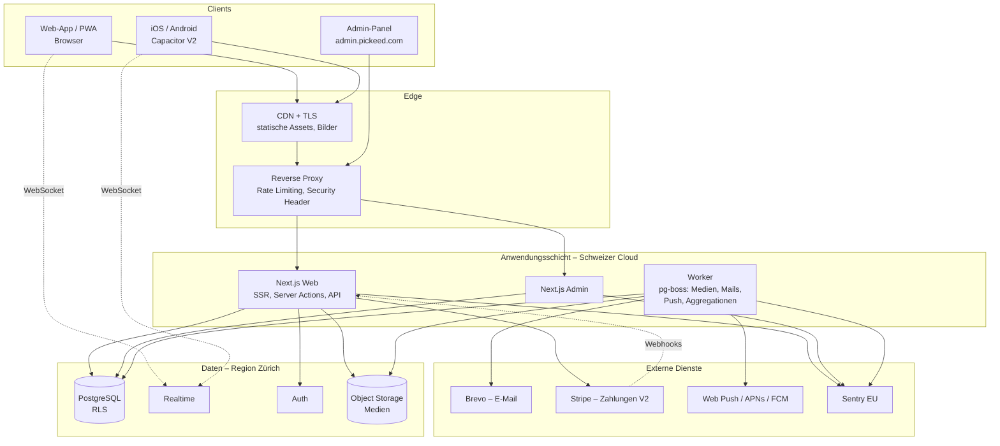

# 04 – Technische Architektur

> **Phase 3 – Technische Architektur** · Stand: 24.11.2026 · Status: Empfehlung zur Freigabe
>
> Diese Empfehlung gilt für **Pfad B (Neuaufbau)**. Für **Pfad A** gilt: Die bestehende Architektur
> (React-SPA + Capacitor + eigene REST-API auf Infomaniak + PostgreSQL bei Supabase in Zürich) wird
> zuerst geprüft und nur dort verändert, wo es einen belegten Grund gibt. Ein Technologiewechsel
> ohne Not ist bei einer Live-Plattform das grösste Risiko.

---

## 1. Entscheidungen auf einen Blick

| Bereich | Empfehlung | Begründung (kurz) | Alternative |
|---|---|---|---|
| Sprache | **TypeScript** durchgehend | Ein Typensystem von Datenbank bis UI, weniger Fehler | – |
| Repository | **Monorepo** (pnpm + Turborepo) | Gemeinsame Typen, UI-Bibliothek, i18n für Web, Admin, Mobile | Mehrere Repos |
| Web-App + Website | **Next.js (App Router, React)** | Serverseitiges Rendern für öffentliche Seiten/Profile/Events (SEO in 4–6 Sprachen), Server Actions, selbst hostbar als Docker-Container | Vite-SPA + Prerendering (wie live) |
| Admin-Panel | **Eigene Next.js-App** auf `admin.pickeed.com` | Getrennte Angriffsfläche, eigene Anmelderegeln (2FA-Pflicht, optional IP-Allowlist) | Admin-Bereich in der Haupt-App |
| Mobile Apps | **PWA zuerst, dann Capacitor** (iOS/Android) | Eine Codebasis, schneller Start; Store-Apps in V2 | React Native / Expo |
| Datenbank | **PostgreSQL 16+** | Relational, transaktional, Row Level Security, Volltextsuche, JSONB, bewährt bei sozialen Graphen bis Millionen Nutzer | – |
| Backend-Plattform | **Supabase, Region Zürich** (Postgres, Auth, Storage, Realtime) | Höchstes Tempo, Open Source mit Exit-Pfad, Region Zürich verfügbar | Rein Schweizer Anbieter (Exoscale/Infomaniak) mit eigener Auth |
| Geschäftslogik | **Next.js Server Actions / Route Handlers + Postgres-Funktionen** | Privilegierte Aktionen nur serverseitig; RLS als zweite Verteidigungslinie | Separater Fastify/Hono-Dienst (ab V2 für Worker) |
| Datenbankzugriff | **Drizzle ORM + SQL-Migrationen** | Typsicher, nahe an SQL, kein Vendor-Lock-in | Prisma |
| Hintergrundjobs | **pg-boss** (Queue in Postgres) | Keine zusätzliche Infrastruktur im MVP | Redis + BullMQ ab Skalierung |
| Echtzeit | **Supabase Realtime** (Broadcast, Presence) | Chat, Tipp-Status, Live-Zusagen ohne eigenen WebSocket-Server | Centrifugo (selbst gehostet) |
| Dateien | **S3-kompatibler Object Storage in der Schweiz** | Datenresidenz, günstig | – |
| Bildverarbeitung | **sharp** (Server) + Grössenreduktion im Client | EXIF/GPS entfernen, AVIF/WebP-Varianten | imgproxy |
| Video (V2) | **ffmpeg-Worker → HLS** | Kontrolle über Kosten und Daten | Mux / Cloudflare Stream (US-Anbieter) |
| Suche | **Postgres Volltext + pg_trgm + unaccent** | Reicht bis weit über MVP | Meilisearch (selbst gehostet, CH) |
| E-Mail | **Brevo** (EU) | Transaktional, EU-Anbieter, live bereits im Einsatz | Postmark (US) |
| Push | **Web Push (VAPID)**, später APNs/FCM | Ohne App-Store nutzbar | – |
| Zahlungen (V2) | **Stripe** (Billing, Connect, TWINT) | Marktplatz-Auszahlungen, TWINT, CHF/EUR | Datatrans, Payrexx, Wallee |
| i18n | **next-intl** mit ICU-Nachrichten | Pluralformen, Formate, typsichere Schlüssel | i18next |
| Fehler-Monitoring | **Sentry (EU-Region)** | Fehler mit Kontext, Releases, Performance | GlitchTip (selbst gehostet) |
| Logs/Metriken | Strukturierte Logs (pino) + OpenTelemetry → Grafana (EU/selbst gehostet) | Standards, kein Lock-in | Better Stack (EU) |
| Uptime | Uptime Kuma (selbst gehostet) oder Better Stack | Externe Verfügbarkeitsprüfung | – |
| Hosting | **Schweizer Cloud** (Infomaniak Public Cloud oder Exoscale) mit Docker | Datenresidenz, Schweizer Vertragspartner | Vercel (einfacher, aber US-Anbieter) |
| CI/CD | **GitHub Actions** | Tests, Builds, Deploy, Sicherheits-Scans | GitLab CI |
| Tests | Vitest, Testing Library, Playwright, pgTAP, axe, k6 | Abdeckung von Unit bis Last | – |

---

## 2. Architekturübersicht



### Schichten und Verantwortung
| Schicht | Verantwortung | Darf nicht |
|---|---|---|
| Client (Web/Mobile) | Darstellung, Eingabe, optimistische Updates, Offline-Cache | Rechte prüfen, Geheimnisse halten, direkt in fremde Daten schreiben |
| Anwendungsschicht | Validierung (zod), Rechteprüfung, Geschäftslogik, Rate Limits, Webhooks | Ungeprüfte Eingaben an die DB geben |
| Datenbank | Integrität (Constraints), RLS als zweite Linie, Transaktionen, Aggregationen | Geschäftslogik verstecken, die nicht getestet ist |
| Worker | Langsame/asynchrone Aufgaben (Bilder, Mails, Push, Statistik) | Nutzeranfragen blockieren |
| Externe Dienste | E-Mail, Zahlungen, Push | Mehr Daten erhalten als nötig |

### Geplante Struktur dieses Repositories (Pfad B)

```
pickeed-website/
├── apps/
│   ├── web/            # Next.js: Website + Web-App + API
│   ├── admin/          # Next.js: Admin-Panel
│   └── mobile/         # Capacitor-Hülle (V2)
├── packages/
│   ├── ui/             # Designsystem: Tokens, Komponenten
│   ├── i18n/           # Übersetzungskataloge, Formatierungs-Helfer
│   ├── db/             # Drizzle-Schema, Migrationen, Seeds
│   ├── core/           # Domänenlogik, Validierung, Rechte
│   └── config/         # ESLint, TS, Tailwind-Presets
├── supabase/           # Lokale Entwicklung, Policies, pgTAP-Tests
├── docs/               # Diese Dokumentation, ADRs
└── .github/workflows/  # CI/CD
```

---

## 3. Begründungen

### Warum Next.js statt reiner SPA (wie live)?
- **Öffentliche Seiten** (Startseite, `@name`, Events) müssen schnell laden und in vier bis sechs
  Sprachen indexierbar sein. Serverseitiges Rendern liefert das ohne separates Prerendering.
- **Ein Framework** für Website und Web-App reduziert Doppelarbeit beim Designsystem.
- **Selbst hostbar** (`output: "standalone"`) – keine Bindung an Vercel, Betrieb in der Schweiz möglich.
- **Wirtschaftlich:** grosse Entwicklerbasis, schnelles Onboarding.

### Warum PostgreSQL + Supabase (Zürich)?
- Soziale Graphen (Folgen, Blockieren, Mitgliedschaften) und Pläne sind relational; Konsistenz ist
  wichtiger als horizontale Schreibskalierung im MVP.
- **Row Level Security** erzwingt Berechtigungen auch bei Fehlern in der API.
- Supabase liefert Auth (E-Mail-Code, Apple, Google, TOTP-MFA), Storage und Realtime – das spart
  geschätzt 6–10 Personenwochen gegenüber Eigenbau.
- **Exit-Pfad:** Supabase ist Open Source; Schema und Daten sind Standard-Postgres. Ein Umzug zu einem
  rein Schweizer Postgres-Anbieter bleibt möglich.
- **Datenschutz-Abwägung:** Supabase Inc. ist ein US-Unternehmen; Daten liegen in Zürich, ein Zugriff
  aus den USA ist vertraglich geregelt, aber nicht ausgeschlossen (so auch in der Live-Datenschutzerklärung
  beschrieben). Wenn «100 % Schweizer Anbieter» ein Markenversprechen werden soll, ist die Alternative
  ein Schweizer Postgres-Dienst mit eigener Auth – Mehraufwand ca. 3–5 Personenwochen. → Entscheidung D2.

### Warum PWA → Capacitor statt React Native?
- Eine Codebasis für Web und Apps; Funktionen erscheinen überall gleichzeitig.
- Pickeed lebt von Links («Freunde machen per Link mit») – die Web-App ist der wichtigste Einstieg.
- Capacitor erlaubt native Push, Kamera, Teilen und Store-Präsenz. Grenzen: aufwändige Animationen
  und Video-Feeds sind nativ besser – falls das zum Kern wird, ist Expo die Option für V3.

### Warum Schweizer Hosting?
- Passt zum Produktversprechen und vereinfacht die Datenschutzkommunikation.
- Kosten sind im MVP-Bereich vergleichbar mit US-Plattformen; Mehraufwand liegt im Betrieb
  (Deployment-Pipeline, Updates), den CI/CD und Container weitgehend automatisieren.

---

## 4. Skalierungspfad

| Stufe | Nutzer (MAU) | Massnahmen |
|---|---|---|
| MVP | bis ~10'000 | 1 Web-Container (2 Instanzen), 1 Worker, Postgres Small, Feed «fan-out on read» mit Keyset-Pagination |
| Wachstum | bis ~100'000 | Horizontale Web-Instanzen, Read-Replica, Valkey/Redis für Cache + Rate Limits, CDN für alle Medien, Partitionierung von `messages`, `notifications`, `activity_events` |
| Skalierung | bis ~1 Mio. | Hybrid-Feed (Fan-out on write für normale Konten, on read für grosse Seiten), dedizierter Realtime-Dienst, Meilisearch, Kubernetes, getrennte Medien-Pipeline |

Grundsatz: Erst messen, dann skalieren. Lasttests (k6) vor jedem Stufenwechsel.

---

## 5. Mehrsprachigkeit (Phase 11, Grundlage ab Phase 7)

### Sprachen und Regionen
| Locale | Sprache | Zahl | Währung | Datum |
|---|---|---|---|---|
| `de-CH` (Standard) | Deutsch (Schweiz) | 1'234'567.5 | CHF 9.90 | 24.11.2026, 19:30 |
| `fr-CH` | Französisch (Schweiz) | 1'234'567,5 | 9.90 CHF | 24 nov. 2026, 19:30 |
| `it-CH` | Italienisch (Schweiz) | 1'234'567.5 | CHF 9.90 | 24 nov 2026, 19:30 |
| `en` (Formate `en-CH`) | Englisch | 1'234'567.5 | CHF 9.90 | 24 Nov 2026, 19:30 |
| `es` (V2) | Spanisch | regionsabhängig | | |
| `pt` (V2) | Portugiesisch | regionsabhängig | | |

*(Beispiele mit `Intl` in Node.js geprüft.)*

### Regeln
- **Keine Texte im Code.** Alle UI-Texte als Schlüssel in `packages/i18n/messages/{locale}.json` (ICU-Format, Plural, Geschlecht).
- **Formate nur über `Intl`** (Datum, Zeit, Zahlen, Währung, relative Zeit, Listen); Zeitzone `Europe/Zurich` als Standard, pro Nutzer änderbar.
- **Schweizer Rechtschreibung:** in `de-CH` kein «ß».
- **Routing:** `/` (de-CH), `/fr`, `/it`, `/en` – mit `hreflang`, lokalisierten Metadaten und Sitemaps.
- **Spracherkennung:** gespeicherte Wahl → Kontoeinstellung → `Accept-Language` → de-CH.
- **Nutzerinhalte** bleiben in Originalsprache; maschinelle Übersetzung auf Wunsch (V2, z. B. DeepL – Datenschutz prüfen).
- **E-Mails und Push** in der Sprache des Empfängers.
- **Qualität:** CI bricht bei fehlenden Schlüsseln ab; Übersetzungen werden von Muttersprachlern geprüft (nicht nur maschinell).

---

## 6. Sicherheit und Datenschutz (Phase 13, gilt ab Phase 5)

> Ziel ist, die Anforderungen des Schweizer DSG und – soweit anwendbar – der DSGVO zu erfüllen.
> Ich mache **keine Aussagen über Konformität oder Zertifizierungen**, die nicht durch eine
> juristische Prüfung bzw. ein Audit belegt sind.

### Datenschutz-Grundsätze
| Prinzip | Umsetzung |
|---|---|
| Datenminimierung | Nur Daten erheben, die eine Funktion braucht; Geburtsdatum nie öffentlich |
| Privacy by Default | Private Profile, private Pläne, Auffindbarkeit in Suchmaschinen nur mit Opt-in |
| Einwilligungsmanagement | Tabelle `consents` (Typ, Version, Zeitpunkt, Widerruf); keine Tracking-Cookies → voraussichtlich kein Cookie-Banner nötig (juristisch bestätigen) |
| Auskunft / Portabilität | Self-Service-Datenexport (JSON + Medien als ZIP) |
| Löschung | Konto löschen: personenbezogene Daten sofort entfernt/anonymisiert; Inhalte in gemeinsamen Plänen als «Gelöschtes Konto»; Backups rollen nach definierter Frist aus |
| Auftragsbearbeitung | AV-Verträge mit allen Dienstleistern; Verzeichnis der Bearbeitungstätigkeiten |
| Risikofolgenabschätzung | DSFA für Minderjährigenschutz, Standortfunktionen und Moderation |
| Datenresidenz | Datenbank und Medien in der Schweiz; Ausnahmen (E-Mail, Zahlungen, Monitoring) dokumentiert |

### Technische Schutzmassnahmen
| Bedrohung | Massnahme |
|---|---|
| Kontoübernahme | Passwortlose Codes (gehasht, kurzlebig, einmalig), optional Passwort (Argon2id), 2FA (Admins Pflicht), Rate Limit pro E-Mail/IP, Sitzungsliste mit «überall abmelden» |
| Sitzungen | Cookies `HttpOnly`, `Secure`, `SameSite=Lax`, Rotation bei Login, kurze Lebensdauer + Refresh |
| SQL Injection | Nur parametrisierte Abfragen (Drizzle/Supabase), kein String-SQL, RLS |
| XSS | React-Escaping, kein ungeprüftes HTML, strikte Content Security Policy mit Nonces, Sanitizing bei Rich Text |
| CSRF | `SameSite`-Cookies + Origin-Prüfung bei allen schreibenden Anfragen (Server Actions prüfen Origin) |
| Unsichere Uploads | Grössen- und Typprüfung per Magic Bytes, Neu-Kodierung aller Bilder, EXIF/GPS entfernen, private Buckets mit signierten URLs, Virenscan für Dokumente |
| Missbrauch / Spam | Rate Limits pro Nutzer und Endpunkt, Kontoalter-Regeln, Link-Prüfung, Sperrlisten, Meldesystem mit Fristen |
| Rechteausweitung | Rechteprüfung serverseitig + RLS; Tests für jede Policy (pgTAP); Admin getrennt mit 2FA |
| Datenabfluss | Verschlüsselung in Transit (TLS 1.2+) und at Rest (Anbieter), verschlüsselte Backups, Secrets nur im Secret-Store |
| Abhängigkeiten | Dependabot, `pnpm audit`, CodeQL, Lockfiles, Renovate-Policy |
| Jugendschutz | Mindestalter 16, Schutz bis 18 (keine Nachrichten von Fremden, nicht in Vorschlägen), Meldegrund «unter 16» |
| Illegale Inhalte | Meldeweg auch ohne Konto, priorisierte Warteschlange, dokumentierte Entscheide; Prüfung von Hash-Abgleich für bekannte Missbrauchsdarstellungen vor Start |

### Löschkonzept (Entwurf)
| Daten | Aufbewahrung |
|---|---|
| Konto, Profil | bis zur Löschung durch Nutzer; danach sofort entfernt |
| Gastdaten | 12 Monate nach letzter Aktivität oder mit dem Plan |
| Beiträge, Kommentare | bis Löschung durch Nutzer oder Konto |
| Chatnachrichten | bis Löschung des Chats/Plans; bei Kontolöschung anonymisiert |
| Meldungen und Moderationsentscheide | 24 Monate (Nachweis), danach anonymisiert |
| Audit-Log Admin | 24 Monate |
| Server-Logs | 30 Tage, IP-Adressen gekürzt |
| Backups | 14–30 Tage rollierend |
| Zahlungsbelege (V2) | 10 Jahre (Aufbewahrungspflicht OR Art. 958f) |

Die Fristen sind ein Vorschlag und werden juristisch bestätigt.

---

## 7. Qualität und Tests (Phase 14, laufend ab Phase 5)

| Ebene | Werkzeug | Abdeckung |
|---|---|---|
| Unit | Vitest | Domänenlogik (Time Pick, Kostenaufteilung, Rechte), Formatierung |
| Komponenten | Testing Library | Designsystem, Formulare, Fehlerzustände |
| Datenbank | pgTAP | Jede RLS-Policy: erlaubt **und** verweigert |
| API / Integration | Vitest + lokale Supabase | Registrierung, Login, Profil, Feed, Beiträge, Interaktionen, Nachrichten, Admin |
| End-to-End | Playwright | Kernflüsse auf Desktop + Mobile-Viewports (iPhone, Android), in 4 Sprachen |
| Barrierefreiheit | axe-core in Playwright | WCAG 2.2 AA auf allen öffentlichen Seiten |
| Last | k6 | Feed, Chat, Login vor jedem Release-Meilenstein |
| Sicherheit | CodeQL, Dependabot, OWASP ZAP Baseline; externer Pentest vor öffentlichem Start | |

**Definition of Done pro Funktion:** implementiert, getestet (automatisch), in allen MVP-Sprachen übersetzt,
mobil geprüft, dokumentiert, im Staging abgenommen. Nicht abgeschlossene Tests werden in
`docs/testprotokoll.md` mit Grund festgehalten.

---

## 8. Deployment und Betrieb (Phase 15 – Überblick)

| Thema | Konzept |
|---|---|
| Umgebungen | `local` → `preview` (pro Pull Request) → `staging` → `production` |
| Konfiguration | Umgebungsvariablen über Secret-Store; `.env.example` dokumentiert alle Variablen ohne Werte |
| Migrationen | Versionierte SQL-Migrationen, nur vorwärts, in CI gegen Staging getestet; destruktive Änderungen in zwei Schritten (expand/contract) |
| Domain / SSL | `pickeed.com`, `www`, `admin.`, `api.` (optional), `media.`; TLS via Let's Encrypt (automatisch), HSTS |
| Backups | Tägliche Vollsicherung + Point-in-Time-Recovery; verschlüsselt; monatlicher Wiederherstellungstest |
| Monitoring | Sentry (Fehler), Metriken/Logs (Grafana), Uptime-Checks, Alarme an Bereitschaft |
| Fehlerprotokollierung | Strukturierte Logs ohne personenbezogene Inhalte, Korrelations-IDs |
| Rollback | Container-Images versioniert → sofortiges Zurücksetzen; Feature-Flags zum Abschalten; DB-Migrationen rückwärtskompatibel |
| Kostenpflichtige Dienste | Werden **erst nach deiner Freigabe** gebucht |
