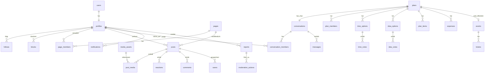

# 05 – Datenbankkonzept

> **Phase 3/5 – Architektur und Datenbank** · Stand: 24.11.2026 · Status: Entwurf zur Freigabe
>
> Zielmodell für PostgreSQL. Bei **Pfad A** dient es als Abgleich mit dem bestehenden Schema;
> bei **Pfad B** als Grundlage für die ersten Migrationen.

---

## 1. Konventionen

| Regel | Festlegung |
|---|---|
| Primärschlüssel | `uuid` (Version 7, zeitlich sortierbar) |
| Zeitstempel | `created_at`, `updated_at` als `timestamptz` (UTC), Anzeige in Nutzerzeitzone |
| Löschen | Nutzerinhalte: `deleted_at` (Soft Delete) + endgültige Bereinigung durch Job; personenbezogene Daten bei Kontolöschung hart gelöscht/anonymisiert |
| Enums | Postgres-`enum` für stabile Werte (z. B. `account_type`), sonst Referenztabellen |
| Namen | `snake_case`, Tabellen im Plural, Fremdschlüssel `<entität>_id` |
| Mehrsprachige Systemtexte | Nicht in der DB, sondern in i18n-Katalogen; DB speichert Schlüssel (z. B. `report_reason = 'spam'`) |
| Geld | `amount_minor bigint` + `currency char(3)` (z. B. 990 + CHF), nie `float` |
| Rechte | Row Level Security auf **allen** Tabellen mit Nutzerdaten; Policies mit pgTAP getestet |
| Zähler | Denormalisierte Zähler (`like_count` …) per Trigger/Job, Wahrheit bleibt in den Detailtabellen |

---

## 2. Domänenübersicht

---

## 3. Tabellen nach Domäne

### 3.1 Identität und Konto
| Tabelle | Wichtige Spalten | Hinweise |
|---|---|---|
| `users` | `id`, `email`, `email_verified_at`, `last_sign_in_at` | Bei Supabase: `auth.users`; nie direkt aus dem Client lesbar |
| `profiles` | `id = users.id`, `username` (unique, citext), `display_name`, `bio`, `avatar_asset_id`, `birthdate` (verschlüsselt/ eingeschränkt), `locale`, `timezone`, `is_private` (default true), `searchable`, `indexable` (SEO, default false), `status` (`active`/`paused`/`suspended`/`deleted`), `age_verified_at` | Öffentliche Felder über View `public_profiles` |
| `guest_identities` | `id`, `plan_id`, `first_name`, `token_hash`, `last_active_at`, `converted_user_id` | Gäste ohne Konto; Löschung nach 12 Monaten Inaktivität |
| `sessions` / `devices` | `user_id`, `device_label`, `push_endpoint`, `platform`, `last_seen_at` | Push-Abos, «überall abmelden» |
| `privacy_settings` | `user_id`, `who_can_message`, `who_can_comment`, `who_can_tag`, `show_read_receipts`, `show_birthday` | Defaults restriktiv; bis 18 erzwungen |
| `consents` | `user_id`, `type`, `version`, `granted_at`, `revoked_at` | AGB, Datenschutz, Push, Kalender, sensible Angaben |
| `data_requests` | `user_id`, `type` (`export`/`delete`), `status`, `file_asset_id`, `expires_at` | Export-Datei mit Ablaufdatum |

### 3.2 Seiten (Creator, Business, Verein) und Rollen
| Tabelle | Wichtige Spalten | Hinweise |
|---|---|---|
| `pages` | `id`, `type` (`creator`/`business`/`brand`/`club`/`provider`), `handle` (unique, teilt Namensraum mit `profiles.username`), `name`, `description`, `category`, `location`, `website`, `social_links jsonb`, `verified_at`, `verified_by` | Eine Person kann mehrere Seiten verwalten |
| `page_members` | `page_id`, `profile_id`, `role` (`owner`/`admin`/`editor`/`analyst`), `invited_by` | Genau ein `owner` pro Seite (Constraint) |
| `verification_requests` | `page_id`, `status`, `evidence jsonb`, `decided_by`, `decided_at`, `reason` | Entscheid im Admin |
| `creator_details` | `page_id`, `roles text[]`, `formats text[]`, `languages text[]`, `region` | V2: Gesuche, Buchungen |

### 3.3 Sozialer Graph
| Tabelle | Wichtige Spalten | Hinweise |
|---|---|---|
| `follows` | `follower_id`, `target_profile_id` **oder** `target_page_id`, `status` (`pending`/`accepted`), `created_at` | Check-Constraint: genau ein Ziel; Index auf beide Richtungen |
| `blocks` | `blocker_id`, `blocked_id` | Block entfernt Follows beidseitig (Trigger); RLS blendet Inhalte aus |
| `close_friends` | `owner_id`, `friend_id` | Status nur für enge Freunde (V2) |
| `mutes` | `owner_id`, `muted_profile_id` / `muted_page_id` | stummschalten ohne Blockieren |

### 3.4 Inhalte
| Tabelle | Wichtige Spalten | Hinweise |
|---|---|---|
| `posts` | `id`, `author_profile_id`, `author_page_id` (optional, «als Seite»), `acting_profile_id`, `type` (`photo`/`video`/`text`/`status`/`memory`), `caption`, `visibility` (`followers`/`public`/`close_friends`/`plan`), `plan_id`, `expires_at` (Status), `like_count`, `comment_count`, `deleted_at` | Status = Post mit `expires_at` |
| `media_assets` | `id`, `owner_id`, `bucket`, `storage_key`, `mime`, `width`, `height`, `duration_ms`, `bytes`, `blurhash`, `variants jsonb`, `processing_status`, `moderation_status` | Nur verarbeitete Assets sind sichtbar |
| `post_media` | `post_id`, `asset_id`, `position`, `alt_text` | Alt-Texte für Barrierefreiheit |
| `reactions` | `post_id`, `profile_id`, `kind` (`heart`) | PK (`post_id`, `profile_id`, `kind`) |
| `comments` | `id`, `post_id`, `author_profile_id`, `parent_id` (1 Ebene), `body`, `deleted_at` | |
| `saves` | `profile_id`, `post_id`, `collection_id` | Sammlungen V2 |
| `hashtags` / `post_hashtags` (V2) | `tag` (citext, normalisiert), `post_id` | |
| `mentions` | `post_id` / `comment_id`, `mentioned_profile_id` | Benachrichtigung + Rechteprüfung |
| `highlights` (V2) | `owner_id`, `title`, `cover_asset_id`; `highlight_items` | |

### 3.5 Kommunikation
| Tabelle | Wichtige Spalten | Hinweise |
|---|---|---|
| `conversations` | `id`, `type` (`direct`/`group`/`plan`/`page`), `title`, `plan_id`, `page_id`, `last_message_at` | |
| `conversation_members` | `conversation_id`, `profile_id` / `guest_id`, `role`, `state` (`active`/`request`/`left`), `last_read_message_id`, `muted_until` | Nachrichtenanfragen = `state = request` |
| `messages` | `id`, `conversation_id`, `sender_profile_id` / `sender_guest_id`, `acting_page_id`, `kind` (`text`/`image`/`system`/`poll`), `body`, `asset_id`, `reply_to_id`, `created_at`, `edited_at`, `deleted_at` | Partitionierung nach Monat ab Stufe «Wachstum» |
| `message_receipts` | `message_id`, `profile_id`, `delivered_at`, `read_at` | Alternativ nur `last_read_message_id` (günstiger) – MVP-Variante |

### 3.6 Pläne und Events
| Tabelle | Wichtige Spalten | Hinweise |
|---|---|---|
| `plans` | `id`, `owner_profile_id`, `page_id` (Business/Verein), `title`, `description`, `category`, `location jsonb`, `starts_at`, `ends_at`, `status` (`draft`/`planning`/`fixed`/`done`/`cancelled`), `visibility` (`private`/`public`), `auto_fix_majority` (bool), `invite_token_hash` | Privat als Standard |
| `plan_members` | `plan_id`, `profile_id` / `guest_id`, `role` (`host`/`cohost`/`member`), `rsvp` (`yes`/`maybe`/`no`/`pending`), `rsvp_at` | |
| `time_options` / `time_votes` | `plan_id`, `starts_at`, `ends_at`; `option_id`, `member_id`, `answer` (`fits`/`maybe`/`no`) | Time Pick |
| `idea_options` / `idea_votes` | `plan_id`, `title`, `place jsonb`, `url`, `proposed_by`; `option_id`, `member_id` | Idea Pick |
| `plan_items` | `plan_id`, `kind` (`bring`/`task`/`wish`), `title`, `assignee_member_id`, `done_at` | Mitbringliste, Aufgaben, Wunschliste |
| `expenses` / `expense_shares` | `plan_id`, `paid_by_member_id`, `amount_minor`, `currency`, `title`; `expense_id`, `member_id`, `share_minor` | Saldo per View berechnet |
| `events` | `plan_id` (1:1), `slug`, `capacity`, `join_mode` (`open`/`request`), `age_min`, `published_at`, `cover_asset_id` | Öffentliche Sicht eines Plans; Chat bleibt privat |
| `ticket_types` / `tickets` | `event_id`, `name`, `price_minor`, `currency`, `quota`; `ticket_type_id`, `holder_profile_id`/`guest_id`, `qr_token_hash`, `status`, `checked_in_at` | MVP: nur Gratis-Tickets |
| `orders` / `payments` / `payouts` (V2) | Stripe-IDs, Beträge, Status, Gebühren | Belege 10 Jahre aufbewahren |

### 3.7 Benachrichtigungen
| Tabelle | Wichtige Spalten | Hinweise |
|---|---|---|
| `notifications` | `id`, `recipient_id`, `type`, `actor_id`, `entity_type`, `entity_id`, `payload jsonb`, `read_at`, `created_at` | Gruppierung («Lea und 3 weitere») in der Abfrage; Aufbewahrung 90 Tage |
| `notification_preferences` | `user_id`, `type`, `channel` (`in_app`/`push`/`email`), `enabled` | |

### 3.8 Moderation und Sicherheit
| Tabelle | Wichtige Spalten | Hinweise |
|---|---|---|
| `reports` | `id`, `reporter_id` (nullable für Meldungen ohne Konto), `entity_type`, `entity_id`, `reason`, `details`, `priority`, `status`, `due_at` | Frist 24 h bei rechtswidrigen Inhalten |
| `moderation_actions` | `report_id`, `admin_id`, `action` (`dismiss`/`hide`/`remove`/`suspend`/`delete_account`), `reason`, `created_at` | Betroffene werden informiert |
| `audit_log` | `id`, `actor_admin_id`, `action`, `target_type`, `target_id`, `metadata jsonb`, `ip_hash`, `created_at` | Nur anhängen (kein UPDATE/DELETE per Policy) |
| `admin_users` | `user_id`, `role` (`super_admin`/`moderator`/`support`/`analyst`), `mfa_enrolled_at`, `active` | Getrennt von normalen Rollen |
| `rate_limit_buckets` | `key`, `window_start`, `count` | MVP; später Valkey |
| `blocklist_terms` / `blocklist_domains` | `value`, `kind`, `created_by` | |

### 3.9 Statistik und KPIs
| Tabelle | Wichtige Spalten | Hinweise |
|---|---|---|
| `activity_events` | `id`, `occurred_at`, `actor_id`, `event` (`post_created`, `plan_fixed` …), `entity_id`, `props jsonb` | First-party, keine Inhalte, keine IP; Partition nach Monat; Rohdaten 13 Monate |
| `daily_metrics` | `day`, `metric`, `dimension`, `value` | Von Worker nächtlich berechnet → Admin-KPIs |
| `page_stats_daily` | `page_id`, `day`, `views`, `profile_visits`, `follows`, `unfollows`, `interactions` | Creator-/Business-Statistik |
| `post_stats_daily` | `post_id`, `day`, `views`, `reactions`, `comments`, `saves`, `shares` | Content-Performance (V2) |

Aggregierte Zielgruppen-Analysen (Region, Altersgruppe) nur ab einer Mindestanzahl (z. B. ≥ 50 Personen pro Segment), damit keine Einzelpersonen erkennbar sind.

### 3.10 Monetarisierung (erst nach Freigabe)
`subscriptions`, `subscription_items`, `invoices` (Spiegel aus Stripe), `stripe_accounts` (Connect),
`promotions` (gesponserte Platzierungen, immer gekennzeichnet), `campaigns`, `campaign_applications`,
`collaborations`.

---

## 4. Berechtigungen in der Datenbank (Beispiele)

| Tabelle | Lesen | Schreiben |
|---|---|---|
| `posts` | Autor; Follower (accepted) bei `followers`; alle angemeldeten bei `public`; Planmitglieder bei `plan`; nie bei Block | Nur Autor bzw. berechtigte Seitenmitglieder |
| `messages` | Nur aktive Mitglieder der Konversation | Nur aktive Mitglieder; nicht bei Block; Anfragen begrenzt (1 Nachricht) |
| `plans` | Mitglieder; öffentlich nur über `events`-View (Name, Ort, Zeit, Beschreibung) | Host/Co-Host |
| `profiles` | Öffentliche Felder über View; volle Daten nur selbst | Nur selbst |
| `audit_log` | Nur Admins | Nur Server-Rolle (anhängen) |

Admin-Zugriffe laufen über die Server-Rolle **mit** expliziter Prüfung der Admin-Rolle in der
Anwendung und Eintrag im Audit-Log – nie direkt aus dem Browser mit erweiterten Rechten.

---

## 5. Feed-Strategie

**MVP – «Fan-out on read»:**
1. Kandidaten = Beiträge der letzten 14 Tage von akzeptierten Follows (Personen + Seiten) + Pläne/Events von Freunden.
2. Ausschluss: Blockierte, Stummgeschaltete, gelöschte, nicht freigegebene Medien.
3. Sortierung: Zeit + einfache Gewichtung (Freunde > Seiten; Interaktion mit Autor in den letzten 30 Tagen).
4. Keyset-Pagination über (`score`, `created_at`, `id`).

Indizes: `posts (author_profile_id, created_at desc) where deleted_at is null`,
`follows (follower_id, status)`, `follows (target_profile_id, status)`.

**Ab ~100'000 MAU:** Hybrid mit vorberechneten Timelines (Fan-out on write für normale Konten,
on read für sehr grosse Seiten), Cache in Valkey.

---

## 6. Migrations- und Datenstrategie

- Migrationen als versionierte SQL-Dateien im Repository (`packages/db/migrations`), Review per Pull Request.
- Jede Migration läuft in CI gegen eine frische Datenbank **und** gegen eine Kopie des Staging-Schemas.
- Seeds nur für lokale Entwicklung und Tests – **nie** Testdaten in Produktion, keine erfundenen Statistiken.
- Bei Pfad A: Schema-Diff zwischen Live-DB und Zielmodell, schrittweise Annäherung über expand/contract.
